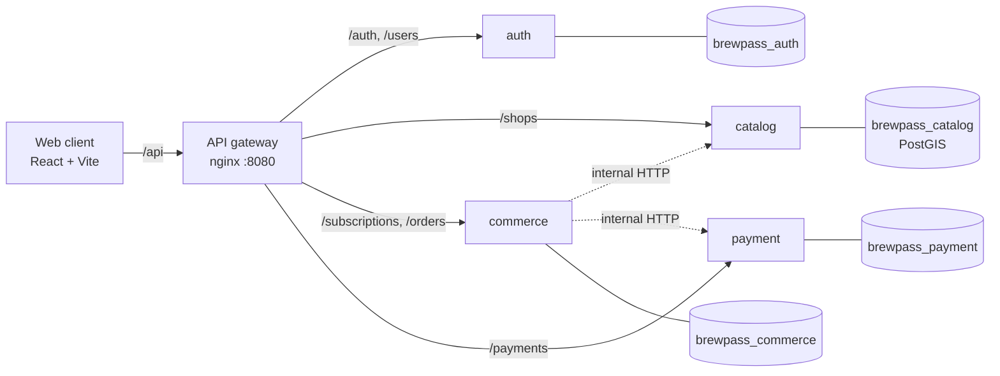

# BrewPass

BrewPass is a location-based coffee subscription platform. Subscribers buy a monthly coffee pass, discover nearby partner coffee shops on an interactive map, customize and place orders against their pass, and pick up their drinks by presenting a signed QR code. Shop owners manage incoming orders through a dedicated dashboard.

## Key Features

- **Phone-based authentication** — sign-up and login with a mobile number and one-time password (OTP), with role-based access for customers, shop owners and admins
- **Subscription plans** — tiered monthly passes with credit tracking, upgrade/downgrade, cancellation and monthly renewal
- **Mobile payment simulation** — checkout flow with success and failure scenarios and payment history
- **Shop discovery** — map view of nearby partner shops with distance, rating and open/closed filters
- **Ordering** — drink customization (size, milk, sugar, extra shots), order history and one-tap reorder
- **QR code pickup** — tamper-proof, signed QR codes verified by the shop at pickup
- **Shop owner dashboard** — order lifecycle management (accepted → preparing → ready → delivered)

## Architecture

BrewPass runs as four Python services behind an nginx API gateway. Each service owns its own PostgreSQL database; the services talk to each other over HTTP on internal routes.



| Service  | Responsibility                                                     |
| -------- | ------------------------------------------------------------------ |
| auth     | Phone + OTP sign-in, RS256 access tokens, refresh tokens, profiles |
| catalog  | Partner shops, opening hours, menus, nearby search (PostGIS)       |
| commerce | Subscription passes, credits, orders and their status              |
| payment  | BrewPass Pay mock card payments                                    |

Only the auth service can sign tokens; every service verifies them locally with the public key. See [ADR 0002](docs/adr/0002-microservices.md) for the boundaries and trade-offs.

## Tech Stack

| Layer     | Technology                                       |
| --------- | ------------------------------------------------ |
| Services  | Python, FastAPI, SQLAlchemy, Alembic             |
| Database  | PostgreSQL 16 + PostGIS (database per service)   |
| Gateway   | nginx                                            |
| Frontend  | React, TypeScript, Vite                          |
| Map       | Leaflet + OpenStreetMap                          |
| Tooling   | Docker Compose, Ruff, pytest, ESLint, Prettier   |

See [ADR 0001](docs/adr/0001-tech-stack.md) for the reasoning behind these choices.

## Project Structure

```
services/
  common/     brewpass-common: shared app factory, errors, logging, security, test helpers
  auth/       auth service
  catalog/    catalog service
  commerce/   commerce service
  payment/    payment service
gateway/      nginx API gateway configuration
frontend/     React + TypeScript web client
docker/       database initialisation
scripts/      setup, key generation, tests and smoke test
docs/adr/     Architecture Decision Records
```

## Getting Started

**Prerequisites:** Docker, Python 3.12+, Node.js 20+.

```bash
# 1. One-time setup: dev keys in ./secrets, .env, and a virtualenv for local tests
scripts/setup-dev.sh

# 2. Database, services and gateway — http://localhost:8080
docker compose up --build

# 3. Frontend — http://localhost:5173 (in a second terminal)
cd frontend && npm install && npm run dev
```

Services apply their migrations and load demo data on start. Useful URLs:

| What                 | URL                                                     |
| -------------------- | ------------------------------------------------------- |
| API docs per service | http://localhost:8080/api/v1/docs/auth (also `catalog`, `commerce`, `payment`) |
| Health               | http://localhost:8080/health/auth (also `catalog`, `commerce`, `payment`) |

Sign in with any Turkish mobile number and the code **`1234`**. Demo accounts are listed in [services/README.md](services/README.md).

### Quality checks

```bash
scripts/test.sh        # lint + tests for every service (needs `docker compose up -d db`)
scripts/smoke.sh       # end-to-end checks through the gateway (needs the full stack)

cd frontend && npm run lint && npm run format:check && npm run build
```

## Project Status

🚧 In active development.

## License

This project is licensed under the [MIT License](LICENSE).
